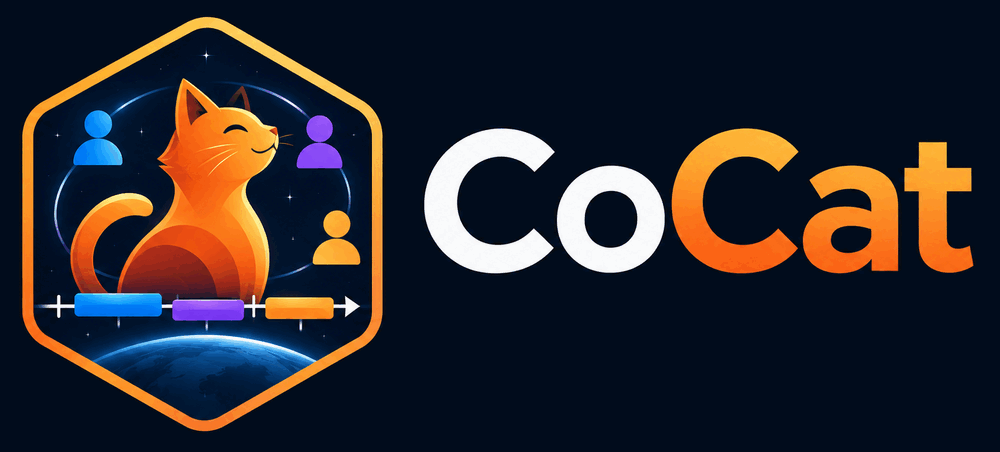

# cocat-rs



The Rust server for cocat: projects over the Yjs sync protocol, the project lifecycle, and the
seeding CLI. The Python `cocat` keeps running until this server is feature-complete; the
wire format and the `.y` project files are shared with it.

A project holds catalogues and their events. Everyone in a project sees all of it, with the
role they were given; an event can belong to several catalogues of one project; history
covers the whole project. The API, the websocket path and the CLI call a project a
*room*. The Python package says project.

## Build

```sh
cargo build --release -p cocat-server
```

The binary is `target/release/cocat-server`.

## Container

```sh
podman build -t cocat-server-rs -f docker/Dockerfile .
podman run -d --name cocat -p 6570:6570 \
    -v cocat-storage:/storage -v cocat-db:/db -v cocat-log:/log \
    cocat-server-rs
```

The image runs as the `cocat` user and keeps the Python image's contract:
`STORAGE_PATH=/storage` for the project files, `DB_PATH=/db` for `cocat-rs.db`, `LOG_PATH=/log`,
`PORT` (build argument, 6570 by default), and the `COCAT_PROXY_PREFIX` and
`COCAT_TRUSTED_PROXIES=1` it sets for a deployment behind one proxy. Every mount is declared
as a volume. The entry point `exec`s the server, so `podman stop` sends it `SIGTERM` and the
open projects are flushed before it exits.

Three wrappers take the same positional arguments as the Python image:

```sh
podman exec cocat create-user you@example.org secret
podman exec cocat add-user-to-room them@example.org my-room
podman exec cocat remove-user-from-room them@example.org my-room
```

`docker/build_and_push.sh testing|release` builds and pushes `:devel` or `:stable` to
`129.104.6.172:32219/sciqlop/cocat-server-rs`; it is not run by anything here, and `:devel`
shares no tag with the Python image.

Running a development copy from production data, and the eventual switch-over, is
documented step by step in [docs/deploy.md](docs/deploy.md).

## Seeding

```sh
cocat-server create-user --email you@example.org --password secret [--is-superuser]
cocat-server set-superuser --email you@example.org [--revoke]
cocat-server create-room --owner you@example.org [--room-id my-room] [--name "My room"]
cocat-server add-user-to-room --email them@example.org --room_id my-room [--role editor]
cocat-server remove-user-from-room --email them@example.org --room_id my-room
cocat-server set-room-owner --email them@example.org --room_id my-room
```

Every command takes `--db_path` (default `./test.db`). Project ids match
`[A-Za-z0-9_-]{1,64}`. `add-user-to-room` takes `--role owner|editor|viewer` and never
lowers an existing role; the owner role is not assignable that way, `set-room-owner` is.

## Serving

```sh
cocat-server serve [--host localhost] [--port 8000] [--update_dir ./updates] [--db_path ./test.db]
```

It prints `listening on <addr>` (`--port 0` lets the kernel pick) and shuts down
gracefully on SIGINT or SIGTERM, after flushing every open project. Project files live in
`--update_dir` as `<room_id>.y`.

### Environment

| Variable | Meaning |
|---|---|
| `COCAT_SECRET` | Secret that signs the mailed links (verification, password reset) and the provider sign-in cookie. Session cookies carry an opaque token the server stores instead of a signature. When it is unset or empty, the server uses `<db_path>.secret`, creating it (mode 0600) on first start. |
| `COCAT_ROOM_MEMORY_BUDGET` | Ceiling in **megabytes** for loaded projects. Unset or empty means no limit; a value that is not a positive integer stops the server at startup and names the variable. A project is charged sixteen times its `.y` file size (a measured 37.8 MB project is ~566 MB resident), so the budget estimates the memory a run can reach rather than measuring it. An open that would exceed the budget is refused; the project stays on disk. |
| `COCAT_ROOM_MAX_MB` | Largest `.y` file one project may reach, 1024 by default. Unset or empty means the default; a value that is not a positive integer stops the server at startup and names the variable. An update that would take the file past the limit is refused: nothing is applied, appended or broadcast, and its sender is closed with 4507 while the other clients stay. |
| `COCAT_OWNER_MAX_MB` | Total `.y` bytes the projects one account owns may reach, 5120 by default, measured when a project opens. Editors' writes count against the owner. Same parsing rules as `COCAT_ROOM_MAX_MB`. |
| `COCAT_METRICS_BIND` | Address for the Prometheus endpoint, such as `127.0.0.1:9187`. Unset or empty exports nothing; a value that is not an address stops the server at startup and names the variable. The endpoint is a separate listener, never the public port. |
| `COCAT_METRICS_TOKEN` | Bearer token for the metrics endpoint. Unset or empty leaves `/metrics` open; anything shorter than 16 characters stops the server at startup and names the variable. The token is never logged and never appears in a label. |
| `COCAT_TRUSTED_PROXIES` | How many proxies stand in front of the server. Unset or empty means zero: the socket address is the client and `X-Forwarded-For` is ignored, because any client can write that header. With `N` proxies the client is the `N`-th hop from the right of `X-Forwarded-For`, believed only when the header carries at least `N` hops. A value that is not a non-negative integer stops the server at startup and names the variable. |
| `COCAT_PUBLIC_URL` | The address users reach this deployment at, scheme and host only (`https://cocat.example.org`; a path, query or fragment is dropped). Every mailed link is built from it plus `COCAT_PROXY_PREFIX`, never from the request's `Host` header, which any client can spoof. A mailer configured without it stops the server at startup and names the variable. |
| `COCAT_PROXY_PREFIX` | Path prefix the reverse proxy adds in front of the application (`/cocat`), used to build links that survive the proxy. Unset or blank means none. |
| `COCAT_SMTP_HOST` | SMTP relay. Unset or empty means the server sends no mail: registration and password reset then have nothing to deliver, and invitations return their token in the response instead of mailing it. |
| `COCAT_MAIL_FROM` | Envelope sender, required with `COCAT_SMTP_HOST` and with `COCAT_MAIL_DIR`. A value that is not a single address, or that carries a line break, stops the server at startup. |
| `COCAT_SMTP_PORT` | Relay port, 587 by default; a value that is not a port number stops the server at startup. |
| `COCAT_SMTP_USERNAME` / `COCAT_SMTP_PASSWORD` | Relay credentials. Give both or neither: a username without a password stops the server at startup, and a password without a username is refused rather than ignored. |
| `COCAT_SMTP_STARTTLS` | Whether to upgrade the connection before sending, on by default. `1`/`true`/`yes`/`on` and `0`/`false`/`no`/`off`, case-insensitive and trimmed; any other value stops the server at startup. |
| `COCAT_MAIL_DIR` | Write one `.eml` file per message instead of talking to a relay, for tests and demos. The directory must already exist (a send that cannot write names the path). Mutually exclusive with `COCAT_SMTP_HOST`: setting both stops the server at startup. |
| `COCAT_OAUTH_PROVIDERS` | JSON list of OpenID Connect providers, empty or unset for none (see [Provider sign-in](#provider-sign-in)). Every provider needs `COCAT_PUBLIC_URL`; a value that is not a JSON list, or a provider whose name is not `^[a-z0-9_-]{1,32}$`, stops the server at startup. A provider whose discovery document cannot be read at startup is skipped with a warning and the server still starts. |

### Login rate limit

`POST /auth/jwt/login` takes ten calls per minute per client (the socket address, or the
trusted hop above); the eleventh answers 429 with a plain body until a minute has passed
since the first call of the window. Every route keeps its own budget, so a flood of login
attempts cannot lock a client out of the rest of the API. The table lives in memory, holds
at most 10 000 clients (the oldest window is evicted first) and is empty again after a
restart.

### Close codes

| Code | Meaning |
|---|---|
| 1008 | access revoked: the member was removed, their role changed, the project was deleted, or the role the handshake granted was no longer confirmed right after the socket attached |
| 1009 | message too large: a frame or message above 16 MiB, the Python server's `ws_max_size` |
| 1013 | try again later: the client fell more than 1024 frames behind, or the project would not fit in `COCAT_ROOM_MEMORY_BUDGET` |
| 1011 | internal error while attaching the socket |
| 4507 | project storage limit reached: an update would take the project file and its history stamps past `COCAT_ROOM_MAX_MB` or its owner's quota |

A handshake that does not offer the websocket subprotocol `cocat.v2` is refused before the
upgrade with HTTP 426: it comes from a client of the first layout (see
[Project layout v2](#project-layout-v2)). A handshake without a valid cookie, or from a user who is
not a member of the project, is refused before the upgrade with HTTP 403.

## Catalogue API

Read-only JSON and VOTable over plain HTTP, for tools that do not speak the sync protocol
(SciQLop, a notebook, curl). Every route needs the `fastapiusersauth` cookie, answers 401 to
an anonymous request and 404 to a non-member, and never keeps a project open: a closed project is
read from its file for the length of the request and dropped again.

```sh
# the room's catalogues, with their event counts
curl --cookie "fastapiusersauth=$TOKEN" \
  http://localhost:8000/api/rooms/my-room/catalogues

# one catalogue
curl --cookie "fastapiusersauth=$TOKEN" \
  http://localhost:8000/api/rooms/my-room/catalogues/6f9c1a52-0b0d-4f4e-9d5e-1b2c3d4e5f60

# the same catalogue as a VOTable
curl --cookie "fastapiusersauth=$TOKEN" \
  -o catalogue.xml \
  http://localhost:8000/api/rooms/my-room/catalogues/6f9c1a52-0b0d-4f4e-9d5e-1b2c3d4e5f60.votable

# one page of events inside a time window
curl --cookie "fastapiusersauth=$TOKEN" \
  'http://localhost:8000/api/rooms/my-room/catalogues/6f9c1a52-0b0d-4f4e-9d5e-1b2c3d4e5f60/events?start=2025-01-01T00:00:00Z&stop=2025-02-01T00:00:00Z&limit=100'
```

Times come back as `YYYY-MM-DDTHH:MM:SS.ffffffZ`; a `start` or `stop` argument accepts that
form, Python's `2025-01-31 10:00:00`, or an explicit offset (`+02:00`), and an argument
without an offset means UTC. Events are ordered by `(start, uuid)`.

**Overlap.** Either bound may be omitted, and an event is returned when its interval overlaps
the requested one (`event.stop >= start` and `event.start <= stop`), so an event that begins
before the window and runs into it is included. A `start` after the `stop` is 422.

**Paging.** `limit` defaults to 1000 and must be between 1 and 10 000. The response carries
`"next"`: an opaque cursor for the following page, or `null` when nothing follows. Send it
back unchanged as `cursor`. The cursor names the `(start, uuid)` of the last event returned,
so events sharing a start time are neither repeated nor skipped.

A malformed time, cursor or limit is 422, an unknown catalogue is 404 `{"detail": "Catalogue
<uuid> not found"}` and a room too big for `COCAT_ROOM_MEMORY_BUDGET` is 503 `{"detail":
"Server memory budget reached"}`. The `.votable` route answers
`application/x-votable+xml` with `content-disposition: attachment; filename="<uuid>.xml"`,
and a catalogue whose events disagree on an attribute's presence or type is 422 with the
exporter's message. The file reads back through cocat's `import_votable`.

## Groups

A group has one owner and any number of members. A project is shared with a group by a grant
(`editor` or `viewer`), and the role a user holds on a project is the highest of their direct
membership and every grant to a group they belong to. A grant can never be `owner`:
ownership only exists as a direct membership. Losing a group, a membership or a grant closes
the sockets that carried it (1008) immediately.

| Route | Who | What |
|---|---|---|
| `GET /api/groups`, `POST /api/groups` | any user | your groups; create one (you own it) |
| `PATCH`/`DELETE /api/groups/{id}` | group owner | rename; delete (revokes every project it carried) |
| `GET /api/groups/{id}/members` | any member | members, by email |
| `DELETE /api/groups/{id}/members/{user_id}` | owner, or yourself | remove a member (the owner cannot leave) |
| `GET /api/rooms/{room_id}/groups` | any project member | the groups the project is shared with |
| `PUT`/`DELETE /api/rooms/{room_id}/groups/{id}` | project owner | grant `{"role":"editor"\|"viewer"}`; unshare |

Group invitations (`POST /api/groups/{id}/invitations`, `GET` to list, `DELETE` to revoke,
plus `POST /api/group-invitations/preview` and `/accept`) always admit a member. When an
email is given and a mailer is configured, the link is mailed and the reply carries no token.

Removing someone from a project directly does **not** remove group access: while a group they
belong to still holds a grant, they keep the project at the group's role. Remove them from the
group, or unshare the project, to cut access.

## Web UI

Server-rendered pages under `{COCAT_PROXY_PREFIX}/ui/`, with the paths and messages of the
Python UI. Every action is a form POST answered by a 303 redirect. Three small static
scripts carry the browser side: `fragment.js` moves a mailed `#token` into a form field,
`confirm.js` asks before a destructive submit, and `copy.js` copies a share link.

| Page | Path |
|---|---|
| Sign in, resend verification | `/ui/login` |
| Sign in with a provider | `/ui/oauth/{name}/login` |
| Sign up | `/ui/signup` |
| Forgot / reset password | `/ui/forgot-password`, `/ui/reset-password#token` |
| Verify an address | `/ui/verify#token` |
| Account, confirm email | `/ui/account`, `/ui/confirm-email` |
| Projects, one project | `/ui/rooms`, `/ui/rooms/{id}` |
| Accept a project invitation | `/ui/invitation#token` |
| Groups, one group | `/ui/groups`, `/ui/groups/{id}` |
| Accept a group invitation | `/ui/groups/join#token` |

- Sessions are the same `fastapiusersauth` cookie as the API. Its value is an opaque
  random token; the server stores only its hash, so logging out, changing or resetting the
  password, and deactivating an account end the sessions that must stop.
- Any request that is not a `GET`, `HEAD` or `OPTIONS` coming from another site is refused
  with 403, on every route: the `Origin` (when sent) must match `Host`, and the
  `Sec-Fetch-Site`, when the browser sends it, must be same-origin or same-site. A client
  that sends neither header, such as the Python client or SciQLop, still passes.
- `?next=` after login only ever leads to a path on this site.
- Login, sign-up, forgot-password and resend are rate-limited (10 per minute per client).
- A message that names something (a project, a group, an address) travels in a short-lived
  `cocat_flash` cookie written by the action's 303 and cleared by the next page view. A
  share link made on a project or group page rides the same way in `cocat_share_link`.
- Invitation tokens stay in the URL fragment or a POST body, so they reach neither an
  access log nor a `Referer` header.

Two deliberate differences from the Python UI:

1. With mail configured, signing up with a taken address looks like a fresh sign-up, and
   the address's owner is mailed about the attempt. Without mail, it still says the
   address is registered.
2. The forgot-password and resend mails are sent in the background, so the answer time
   doesn't reveal whether the address has an account.

### Provider sign-in

Sign-in through OpenID Connect is configured with `COCAT_OAUTH_PROVIDERS`, a JSON list
whose entries follow the Python configuration:

```sh
export COCAT_PUBLIC_URL=https://cocat.example.org
export COCAT_OAUTH_PROVIDERS='[
  {"name": "orcid",
   "discovery_url": "https://orcid.org/.well-known/openid-configuration",
   "client_id": "APP-...",
   "client_secret": "...",
   "scopes": ["openid"]}
]'
```

`discovery_url` is the provider's discovery document; the redirect URI is
`{COCAT_PUBLIC_URL}{COCAT_PROXY_PREFIX}/ui/oauth/{name}/callback`, built from the
configuration and never from the request's `Host` header, so the provider must have that
exact address registered as a client redirect URI. Each configured provider adds a "Sign
in with {name}" link to the login page. The flow uses PKCE and a nonce; the verifier,
nonce and CSRF state ride in one signed `cocat_oidc` cookie (ten minutes, scoped to
`/ui/oauth/`), and no provider token is stored after the callback.

An address the provider returns is believed only when the provider is marked
`"verifies_email": true` and the address parses; otherwise the account gets
`{subject}@{name}.placeholder.cocat.org` and is sent to `/ui/confirm-email` to name a real
address. With a mailer configured, a trusted address links to an existing local account
only when that account is already verified; an unverified one answers
`/ui/login?error=exists`, and without a mailer no association is made at all. A
placeholder address never links to an account and is never verified. A sign-in with a
known subject reaches the same account every time.

Differences from Python beyond the stored-token rule: the Python `Sec-Fetch-Site: none`
refusal is dropped, so a bookmark or a typed `/ui/oauth/{name}/login` URL works (a
cross-site one is still refused with 403); the login route's rate limit answers a 303 with
`?error=too_many` rather than Python's 429; and the JSON API pair
`/auth/{name}/authorize|callback` is not implemented.

Providers are documented as ORCID first: `scopes` is `["openid"]`, which returns no address,
and even with the email scope ORCID does not prove control of it, so a real deployment
leaves `verifies_email` off. Every ORCID user therefore lands on `/ui/confirm-email` and
names a real address after one click from the inbox.

## Durability

Every update is written to the project file before it is broadcast, so a crash of the process
loses nothing a client has seen. The file is fsynced every second, and on unload, delete,
flush and shutdown, so a power loss can lose at most one second of acknowledged edits. The
file is the `0.0.1` append-only format the Python server writes; a record cut by a crash is
detected at open and dropped.

## Moving from the Python server

`import` copies a running Python cocat deployment into this server's database in one
idempotent command:

```sh
cocat-server import --update-dir ./updates --db ./test.db --users ./python.db
```

`--users` is the Python `--db_path` (the SQLite file, not its `.secret` sibling);
`--update-dir` is the directory both servers keep `<room_id>.y` in. `--owner
you@example.org` names the Rust account that takes every room file in `--update-dir` the
imported database does not list: `--users` and `--owner` may be given together, and at
least one is required. `--dry-run` prints the same summary and writes nothing.

Both Python schemas import. The released one stores each user's projects as a JSON list:
every listed project becomes a project named by its id, everyone listed is an editor, and an
owner is picked by the rule of Python's migration (the first member by address whose local
part names the project, else the first member by address); accounts from it come in verified.
The rooms schema (`room`, `membership`, `invitation`, `oauth_account`) is copied as it
stands.

Users keep their id, address, password hash and flags. Login accepts the bcrypt hashes
older Python accounts hold and rehashes them to Argon2 on the first successful sign-in.
Projects keep their name and timestamps, memberships their role, invitations their token hash
(so a live link keeps working on this server) and uses, and linked accounts their provider
and subject; the provider tokens are dropped.

The Python database is opened read-only. Project files are rewritten in the v2 layout (next
section); running the command twice changes nothing the second time. The import refuses to run when `--db` and `--users` name the
same file, and stops before writing anything when an address already belongs to an account
here.

Run the import on a copy of the project files, and keep the Python database and the original
project files until the Rust server has run for a while: they are the way back.

### Project layout v2

Python cocat stores projects in the first layout. This server and `cocat_rs` only use layout
v2, and the two do not mix:

- `import` migrates every project file in `--update-dir` to v2 by appending one record.
- The server refuses to serve a project file still in the first layout (an error log names the
  project): run the import on it.
- Python cocat and SciQLop plugin versions built on it do not offer the `cocat.v2`
  subprotocol, so their handshake is refused with 426 before they can write the first
  layout into a v2 project. Users update the plugin.
- A `cocat_rs` cache holding the first layout is discarded when the project opens, and the
  project is fetched again from the server.

Session cookies do not survive the move. The Python server signs them and this one keeps
its own session table, so every user signs in once again after the switch.

## API documentation

`/docs` serves the Swagger UI page and `/openapi.json` the OpenAPI 3.1 document behind it;
both are public, so the shape of the API can be read before signing in. The document covers
every JSON route (`/api`, `/auth`, `/users` and the two legacy room routes), names the
`fastapiusersauth` cookie as its `apiKey` security scheme, and marks the operations that need
a session. The rendered pages and the websocket handshake are not part of it.

Behind a reverse proxy, `COCAT_PROXY_PREFIX` reaches the document's `servers` entry and the
URL the page fetches, while the routes themselves stay where the proxy forwards them.

## Metrics

`COCAT_METRICS_BIND=127.0.0.1:9187` serves the Prometheus text at
`http://127.0.0.1:9187/metrics`, on its own listener so nothing appears on the public port.
Labels are fixed route templates, never a project id, an address or a request URI, and the
counters on the websocket path allocate nothing per frame. Databases counts and file sizes
are sampled every 60 seconds, so a scrape never queries the database or walks the disk.

With `COCAT_METRICS_TOKEN` set, the endpoint answers 401 with `WWW-Authenticate: Bearer`
unless the request carries `Authorization: Bearer <token>`, compared in constant time.

```yaml
scrape_configs:
  - job_name: cocat
    authorization:
      credentials: <the token>
    static_configs:
      - targets: ["127.0.0.1:9187"]
```

## Python package

`crates/cocat-py` builds `cocat_rs`, a Python package over the same document: a project held in a
directory, and either read and written locally or synchronised with a server.

```sh
# from a checkout, into the environment you are using
maturin develop -m crates/cocat-py/Cargo.toml
# or install the wheel it builds
pip install target/wheels/cocat_rs-*.whl
```

Before 0.3.0 the package said room: `Room`, `RoomInfo`, `rooms()` and `room_id=`. Those
names still work in 0.3 with a `DeprecationWarning` naming the new one, and go in 0.4.

**Script mode** works on the cached copy, as cocat's own API does:

```python
from cocat_rs import api

api.set_config(host="http://localhost:8000", file_path="/tmp/cocat", project_id="my-room")
api.log_in("you@example.org", "secret")
catalogue = api.create_catalogue(name="events", author="you@example.org")
api.save()
```

**Client mode** keeps the same `Project` in step with a server through the websocket.
`connect` takes the server's address, the one you log in to (with its path prefix behind a
proxy), and adds `/room/<id>` itself:

```python
import cocat_rs

url = "http://localhost:8000"
cookie = cocat_rs.login(url, "you@example.org", "secret")
project = cocat_rs.Project.open("/tmp/cocat", "my-room")
project.connect(url, cookie, credentials=("you@example.org", "secret"))
project.wait_synced(10)

print(project.status)                   # offline, connecting, synced, unauthorized

event = project.event("<a uuid>")
print(event.catalogues)                 # the uuids of the catalogues listing it
print(project.event_arrays([event], attributes=True))
```

Events carry more than a range: `status` (`preliminary`, `confirmed`, `reviewed`, `final`,
`rejected`), `confidence` (0 to 1), `start_err` and `stop_err` (seconds), `origin` (what made
the event, from `project.create_origin(...)`), `source_id`, `created`, `comment` and a TFCat
`shape`. All are settable and all are keyword arguments of `create_event`. Attributes register
their type in the project (`project.attribute_types()`); writing another type warns but is kept.

```python
event = project.create_event(start, stop, author="you@example.org", confidence=0.8,
                             tags=["shock"], attributes={"density": 12.5})
event.status = "reviewed"
event.delete()                          # to the trash: hidden from every list
project.trash()                         # [event]
event.restore()                         # or event.purge(), for good
```

A **smart catalogue** has a `rule`: its members are its listed events plus what the rule
yields, computed on every read, so it follows the project as people edit it.

```python
smart = project.create_catalogue(name="strong shocks")
smart.rule = {"filter": {"all": True},
              "where": {"and": [{"contains": ["tags", "shock"]},
                                {"cmp": ["confidence", ">=", 0.7]}]}}
smart.events                            # the events it holds now
smart.event_arrays()                    # every member; a merged interval has uuid None
                                        # and the events it came from in "sources"
snapshot = smart.materialize("strong shocks, today")   # a static copy
```

A malformed rule raises `ValueError` saying where: `rule.where.cmp: unknown operator '=~'`.
The rule format (sets, interval operators, predicates) is in
`docs/superpowers/specs/2026-11-07-catalogue-engine-v2-design.md`, section 3.

**tscat** databases and JSON files import into a project, keeping uuids, so importing again
updates rather than duplicates. A rating becomes a confidence (rating / 10), removed items go
to the trash and dynamic catalogues become smart ones.

```python
from cocat_rs import tscat

tscat.import_database(project)          # the local tscat database: pip install 'cocat-rs[tscat]'
tscat.import_json(project, "export.json") # tscat's JSON, no tscat needed
tscat.export_json(project, [smart], "out.json")
```

tscat writes a dynamic catalogue's predicate into its JSON as Python text, so `import_json`
keeps such a catalogue's members without a rule, and warns.

**History.** The server keeps every version of a project: a run of changes by one person with
no gap over five minutes, and no longer than an hour. Each version says who made it, when, and how many events it added,
changed or removed. `cocat_rs.history` lists them, newest first, as dicts; `catalogue=` keeps
the versions that touched one catalogue or its events. `Project.at` fetches the project as it
was at a version: it is read-only (a write raises `RuntimeError`) and needs no connection once
fetched. `cocat_rs.restore` makes the project, or one catalogue, equal to a version again, as one
new change by you, so a restore can itself be undone; events created since go to the trash.
A restore is always a version of its own, with `restored_from` set to the version it brought
back. A version's `id` is its first change, so it stays the same, and keeps its name, while
its author goes on editing.
`cocat_rs.commit` saves the newest version on purpose: it ends at the project's last change
the server has, with an optional `name` and `message` (a note, up to 2000 characters), and
returns its id. Call `project.save()` first so your pending edits reached the server. The next
change starts a new version, and the list marks the saved one with `committed` and its
`message`. Saving again with nothing new raises `cocat_rs.Conflict`.
`cocat_rs.copy_version(url, cookie, project_id, version, name)` makes a new project, owned by
you, that starts as the version: same catalogues, events (with their uuids), rules and trash.
It returns the new project's id. Any member may copy, a viewer too; the copy counts against
your storage quota. The original and its history stay as they were.

```python
versions = cocat_rs.history(url, cookie, "my-room")
first = versions[-1]["id"]
past = cocat_rs.Project.at(url, cookie, "my-room", first)
past.catalogues()                       # as they were
cocat_rs.name_version(url, cookie, "my-room", first, "before the import")
project.save()
cocat_rs.commit(url, cookie, "my-room", name="paper v1", message="as submitted")
cocat_rs.restore(url, cookie, "my-room", first)   # False when nothing differed
trial = cocat_rs.copy_version(url, cookie, "my-room", first, "my-room (copy)")
```

**Errors.** When the server refuses a call (`login`, `projects`, `history`, `Project.at`,
`restore`, `name_version`, `commit`, `copy_version`), the error says why. `cocat_rs.Unauthorized` (401)
means the session expired or there is none: log in again. `cocat_rs.Forbidden` (403) means
your role does not allow it, `cocat_rs.ServerNotFound` (404) that the project or version does
not exist, and `cocat_rs.Conflict` (409) that the call clashes with the project, e.g. nothing
to save. Any other refusal is their base, `cocat_rs.ServerError`. Each carries `status` and
`detail`, the server's own text, which is also the message. `ServerError` subclasses
`ValueError`, so older `except ValueError` code still catches it, and `ServerNotFound` is
also a `cocat_rs.NotFound`.

```python
try:
    cocat_rs.commit(url, cookie, "my-room")
except cocat_rs.Unauthorized:
    cookie = cocat_rs.login(url, email, password)
except cocat_rs.Conflict as error:
    print(error.detail)   # Nothing changed since the last saved version.
```

`credentials` is what lets the client recover a session the server ended (a password change,
a deactivation, a restart with a new database): the sync task logs in again once, swaps the
cookie and retries, and only a refusal right after a fresh login, or a login that fails, ends
in `unauthorized`. Without `credentials` a refused session is final, as before.
`project.set_cookie(...)` replaces the cookie of a running connection.

A listener hears the project's changes on the loop it was registered from:

```python
class Listener:
    def status(self, value):
        print("the project is now", value)

    def catalogue_added(self, uuid):
        print("new catalogue", uuid)

    def changes_done(self):
        pass

handle = project.listen(Listener())
handle.close()
```

`status` is called once with the current status right after registration, then on every
change; a method the listener does not have is skipped, and one that raises is logged without
stopping the batch. Unknown catalogues and events raise `cocat_rs.NotFound`, which subclasses
both `LookupError` (what Python's mappings raise) and `RuntimeError` (what this package raised
before it named the case), so both `except LookupError` and old `except RuntimeError` code
still catches it.

## Tests

```sh
cargo fmt --all --check
cargo clippy --all-targets -- -D warnings
cargo test --workspace
```

`bench/` holds the phase 0 gate harness (see `bench/README.md`).
