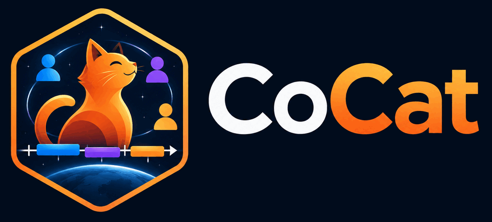

# cocat

**cocat keeps lists of time intervals that you and your colleagues build together.**

You spot a shock in the solar wind. A colleague finds a magnetopause crossing. A student marks
a type III burst. Each of these is an **event**: a start time, a stop time, and whatever you
want to say about it. A named list of events is a **catalogue**.

cocat stores your catalogues on a server and keeps everyone in step, live. You can work on them
from three places, and they all see the same thing:

- **your web browser**: browse, edit, search, share, review;
- **[SciQLop](https://sciqlop.github.io)**: mark intervals while you look at the data;
- **Python and Jupyter**: create events from your detection code, read them back for statistics.

<figure>
--8<-- "sync.svg"
<figcaption>Every app syncs with one server. SciQLop and Python keep a copy on your disk, so they also work offline.</figcaption>
</figure>

Nothing is lost. Every change is kept in the history, so you can always go back.

## What do you want to do?

| I want to… | Read |
|---|---|
| try it in ten minutes | [Getting started](getting-started.md) |
| understand the words (project, catalogue, smart catalogue…) | [Key ideas](concepts.md) |
| build an event list with my team | [Build a catalogue with your team](guides/team-catalogue.md) |
| use cocat from a notebook or a script | [Python and Jupyter](guides/python.md) |
| bring my tscat, AMDA, VOTable or CSV catalogues | [Bring your catalogues in](guides/import-export.md) |
| use DONKI, the CDAW CME list, STIX flares… | [Community catalogues](guides/public-catalogues.md) |
| freeze the exact list behind a paper | [Catalogues for a paper](guides/paper.md) |
| have people check what my detection pipeline found | [Review rounds](guides/rounds.md) |
| run a class or a student project | [Teaching with cocat](guides/teaching.md) |
| find events by tag, date, confidence… | [Search](reference/search.md) |

## Who is it for?

cocat was made for space physics, alongside SciQLop. But nothing in it is specific to space:
any work that turns data into lists of time intervals can use it. Sleep stages, seismic
events, telescope observing windows, labelled sections of a recording: all of these are
catalogues of events.

You don't need to install anything to start. A browser and an account are enough.
Python and SciQLop come later, when you need them.

!!! note "Where is the server?"
    Your team or your lab runs a cocat server, or you use the one SciQLop runs at
    `https://sciqlop.lpp.polytechnique.fr/cocat-dev`. Ask whoever invited you if you're not
    sure. The rest of this documentation works the same on any server.
